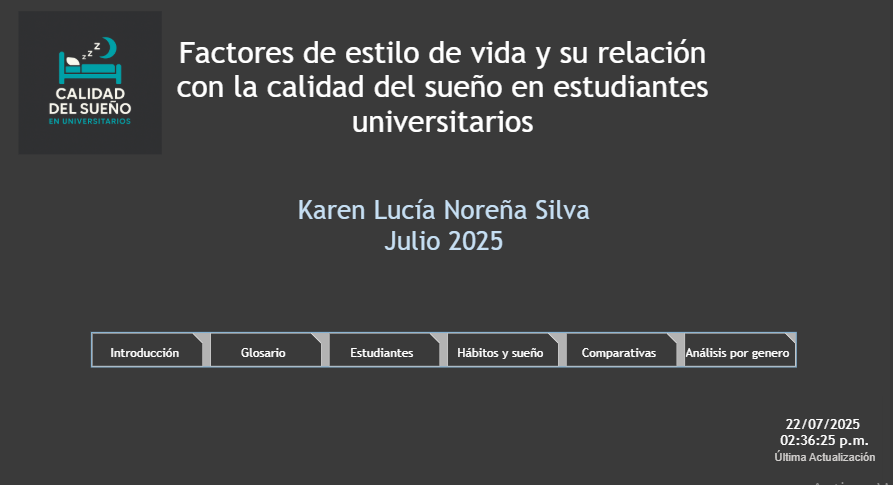
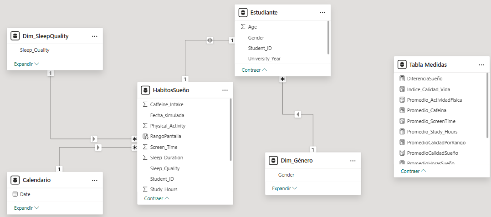
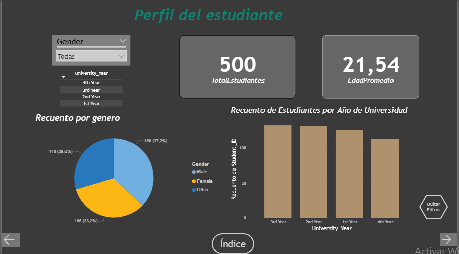
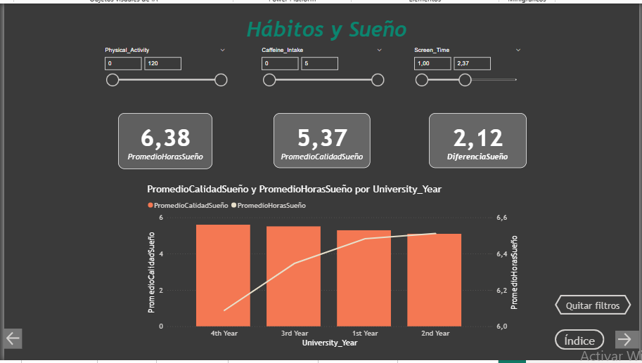
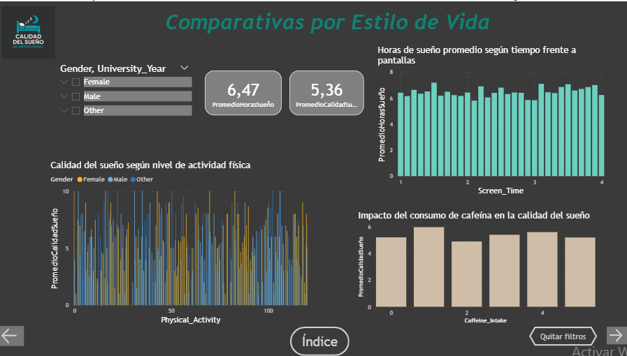

# Calidad del sueño en estudiantes universitarios: tablero en Power BI

Proyecto final del curso de Análisis de Datos con Power BI (CoderHouse, 2025). Tablero interactivo de 7 páginas que explora cómo se relacionan los hábitos de vida de estudiantes universitarios (pantallas, cafeína, actividad física y estudio) con la calidad de su sueño.

## 🎯 Objetivo e hipótesis
**Objetivo:** analizar la relación entre el estilo de vida de los estudiantes y la calidad de su sueño.

**Hipótesis:** los estudiantes con mejores hábitos (menos pantallas por la noche, más actividad física y menos cafeína) tienen mejor calidad de sueño que quienes tienen hábitos menos saludables.

**Usuarios finales:** orientadores estudiantiles, bienestar universitario, psicólogos universitarios y personal académico. Nivel de análisis táctico y operativo.

## 📊 Datos
| | |
|---|---|
| Fuente | Dataset público de Kaggle sobre hábitos de sueño de estudiantes universitarios |
| Tamaño | 500 estudiantes · 14 variables |
| Variables | Edad, género, año universitario, horas de sueño, horas de estudio, tiempo de pantalla, cafeína, actividad física, calidad del sueño (1–10) y horarios de dormir y despertar entre semana y fin de semana |
| Calidad | Sin valores nulos ni duplicados |

El archivo está en `data/sueno_universitarios.csv`.

## 🗂️ Modelo de datos
Se dividió el dataset en tablas relacionadas: `Estudiante` y `HabitosSueño` (relación 1:1 por `Student_ID`), dimensiones de género y calidad del sueño, una tabla de calendario y una tabla de medidas.

## 🔧 Transformaciones y medidas DAX
**Power Query y modelado**
- Corrección de tipos de datos (decimal y entero) en las variables de sueño, pantalla y actividad física.
- Renombrado de columnas con caracteres problemáticos, como comas.
- Columna calculada `Fecha_Simulada`, para poder construir un calendario, porque la base no trae fechas.
- Columna calculada `RangoPantalla`, que agrupa a los estudiantes en cinco categorías según sus horas de pantalla.

**Medidas principales**
| Medida | Fórmula | Qué muestra |
|---|---|---|
| `TotalEstudiantes` | `DISTINCTCOUNT(Estudiante[Student_ID])` | Estudiantes en la muestra |
| `PromedioHorasSueño` | `AVERAGE(HabitosSueño[Sleep_Duration])` | Horas de sueño promedio |
| `PromedioCalidadSueño` | `AVERAGE(HabitosSueño[Sleep_Quality])` | Calidad del sueño promedio (1–10) |
| `DiferenciaSueño` | `AVERAGE(HabitosSueño[Weekend_Sleep_End]) - AVERAGE(HabitosSueño[Weekday_Sleep_End])` | Cuánto más tarde se despierta la gente el fin de semana |

También hay medidas de promedio de actividad física, cafeína, tiempo de pantalla y horas de estudio.

## 🖥️ Páginas del tablero
1. **Índice:** portada y navegación.
2. **Introducción:** contexto, objetivo e hipótesis.
3. **Glosario:** definición de cada variable.
4. **Estudiantes:** perfil de la muestra por género, edad y año universitario.
5. **Hábitos y sueño:** promedios de sueño y calidad, con filtros por actividad física, cafeína y pantalla.
6. **Comparativas:** sueño según pantalla, actividad física y cafeína.
7. **Análisis por género:** calidad y duración del sueño por género.

## 📈 Datos de la muestra
- **500 estudiantes:** 186 hombres (37,2 %), 166 mujeres (33,2 %) y 148 de género "Other" (29,6 %).
- **Edad promedio:** 21,5 años.
- **Sueño promedio:** 6,5 horas por noche.
- **Calidad del sueño promedio:** 5,4 sobre 10.
- **Fin de semana:** se despiertan en promedio 2,1 horas más tarde que entre semana.

## 🔍 Verificación de la hipótesis
Se calcularon correlaciones de Pearson entre cada hábito y la calidad del sueño:

| Hábito | r con la calidad del sueño | p |
|---|---|---|
| Tiempo de pantalla | +0,009 | 0,83 |
| Actividad física | −0,014 | 0,76 |
| Consumo de cafeína | −0,006 | 0,89 |
| Horas de estudio | +0,059 | 0,19 |

**En esta muestra, ninguno de los hábitos medidos se asocia con la calidad del sueño:** las correlaciones son prácticamente cero. Tampoco hay diferencias significativas por género (mujeres 5,55 · otros 5,47 · hombres 5,10; ANOVA p = 0,31) ni por año universitario (p = 0,86). La hipótesis no se sostiene con estos datos.

## ⚠️ Limitaciones
- **Análisis descriptivo y de una sola muestra:** no establece causalidad.
- **La calidad del sueño es autopercibida** (escala de 1 a 10).
- **`Fecha_Simulada` no representa fechas reales:** cualquier vista temporal es solo ilustrativa.
- **Inconsistencias en los datos:** el 48 % de los estudiantes tiene una "hora de dormir" entre semana entre las 8:00 y las 18:00, y la duración del sueño no guarda relación con las horas de inicio y fin registradas (r = 0,006). Los valores se reparten de forma pareja dentro de rangos fijos, lo que sugiere un conjunto de datos de práctica.
- **Próximo paso:** repetir el análisis con datos reales, por ejemplo una encuesta institucional de bienestar.

## ▶️ Cómo abrirlo
Descarga `powerbi/Calidad_Sueno_Universitarios.pbix` y ábrelo con **Power BI Desktop** (gratuito para Windows).

## 🧰 Herramientas
Power BI (Power Query, modelado de datos y DAX) · Lucidchart (diagrama entidad-relación) · Kaggle (fuente de datos)
